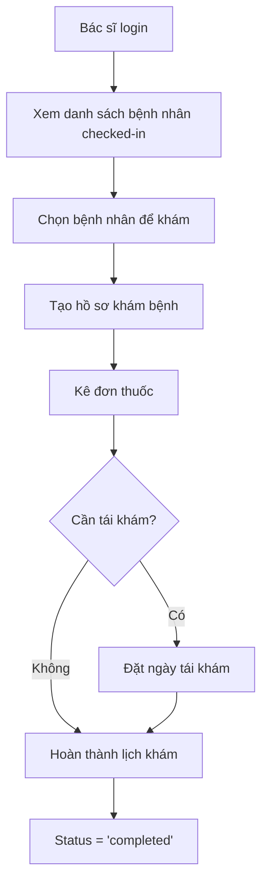
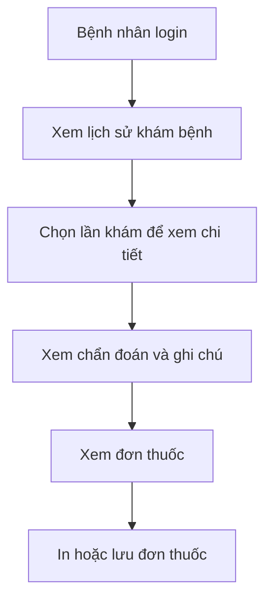

# Medical Records Management System - Backend

## 📋 Tổng quan

Hệ thống quản lý hồ sơ y tế cho phòng khám THCT Clinic, cho phép bác sĩ tạo và quản lý hồ sơ khám bệnh, kê đơn thuốc, và bệnh nhân xem lịch sử khám bệnh của mình.

## ✨ Tính năng chính

### 🩺 Quy trình bác sĩ
- ✅ Xem danh sách bệnh nhân đã check-in hôm nay
- ✅ Tạo hồ sơ khám bệnh cho lịch hẹn
- ✅ Kê đơn thuốc (batch insert với transaction)
- ✅ Đặt lịch tái khám
- ✅ Hoàn thành lịch khám

### 👤 Quy trình bệnh nhân
- ✅ Xem lịch sử khám bệnh
- ✅ Xem chi tiết từng lần khám
- ✅ Xem đơn thuốc chi tiết

### 🏥 Quy trình lễ tân
- ✅ Truy xuất hồ sơ khám bệnh của bất kỳ bệnh nhân nào
- ✅ Hỗ trợ bệnh nhân khi cần thông tin

## 🏗️ Kiến trúc hệ thống

```
backend/
├── src/
│   ├── controllers/
│   │   └── medicalRecordsController.js    # Controller chính
│   ├── routes/
│   │   ├── medicalRecordsRoutes.js        # Medical records routes
│   │   └── appointmentRoutes.js           # Complete appointment route
│   ├── middleware/
│   │   └── authMiddleware.js              # Authentication & Authorization
│   └── server.js                          # Server entry point
├── docs/
│   └── MEDICAL_RECORDS_API.md             # API documentation
└── database/
    └── add_indexes_medical_records.sql    # Database migration
```

## 🗄️ Cơ sở dữ liệu

### Tables

**medical_records**
```sql
CREATE TABLE medical_records (
  id INT PRIMARY KEY AUTO_INCREMENT,
  appointment_id INT UNIQUE,
  symptoms TEXT,
  diagnosis TEXT,
  note TEXT,
  reexamination_date DATE NULL,
  created_at TIMESTAMP DEFAULT CURRENT_TIMESTAMP,
  FOREIGN KEY (appointment_id) REFERENCES appointments(id) ON DELETE CASCADE
)
```

**prescriptions**
```sql
CREATE TABLE prescriptions (
  id INT PRIMARY KEY AUTO_INCREMENT,
  medical_record_id INT,
  medicine_name VARCHAR(150) NOT NULL,
  dosage VARCHAR(100) NOT NULL,
  quantity INT NOT NULL,
  instructions TEXT,
  FOREIGN KEY (medical_record_id) REFERENCES medical_records(id) ON DELETE CASCADE
)
```

### Indexes
```sql
-- Speed up doctor queue queries
CREATE INDEX idx_appointments_doctor_date_status 
ON appointments(doctor_id, appointment_date, status);
```

## 🚀 API Endpoints

### Doctor Endpoints (Bác sĩ)
| Method | Endpoint | Description |
|--------|----------|-------------|
| GET | `/api/medical-records/checked-in` | Xem danh sách bệnh nhân đã check-in |
| POST | `/api/medical-records` | Tạo hồ sơ khám bệnh |
| POST | `/api/medical-records/:id/prescriptions` | Kê đơn thuốc |
| PUT | `/api/medical-records/:id/reexamination` | Cập nhật ngày tái khám |
| PUT | `/api/appointments/:id/complete` | Hoàn thành lịch khám |

### Patient Endpoints (Bệnh nhân)
| Method | Endpoint | Description |
|--------|----------|-------------|
| GET | `/api/medical-records/patient/history` | Xem lịch sử khám bệnh |

### Shared Endpoints (Dùng chung)
| Method | Endpoint | Description | Roles |
|--------|----------|-------------|-------|
| GET | `/api/medical-records/:id` | Xem chi tiết hồ sơ | Patient, Doctor, Receptionist |
| GET | `/api/medical-records/:id/prescriptions` | Xem đơn thuốc | Patient, Doctor, Receptionist |

### Receptionist Endpoints (Lễ tân)
| Method | Endpoint | Description |
|--------|----------|-------------|
| GET | `/api/medical-records/patient/:patientId` | Xem hồ sơ của bệnh nhân |

📖 **Chi tiết API:** Xem [MEDICAL_RECORDS_API.md](./docs/MEDICAL_RECORDS_API.md)

## 🔐 Bảo mật

### Authentication
- Tất cả endpoints yêu cầu JWT token trong Authorization header
- Token format: `Bearer <jwt_token>`

### Authorization
Hệ thống có 3 cấp độ phân quyền:

1. **Role-based** (Dựa trên vai trò)
   - `doctorOnly`: Chỉ bác sĩ
   - `patientOnly`: Chỉ bệnh nhân
   - `receptionistOnly`: Chỉ lễ tân

2. **Ownership-based** (Dựa trên quyền sở hữu)
   - Bác sĩ chỉ truy cập bệnh nhân của mình
   - Bệnh nhân chỉ xem hồ sơ của mình
   - Lễ tân xem được tất cả

3. **Status-based** (Dựa trên trạng thái)
   - Chỉ tạo hồ sơ cho appointment có status "checked_in"
   - Chỉ hoàn thành appointment có medical record

### Validation
- ✅ Input validation cho tất cả fields
- ✅ Date validation (reexamination_date phải là tương lai)
- ✅ Quantity validation (phải > 0)
- ✅ Medicine name validation (không được rỗng)
- ✅ Unique constraint (1 appointment chỉ 1 medical record)

## 🧪 Testing

### Unit Tests
```bash
cd backend
npm test -- medicalRecordsController.test.js
```

### Manual Testing với cURL

**1. Login để lấy token:**
```bash
curl -X POST http://localhost:5000/api/auth/login \
  -H "Content-Type: application/json" \
  -d '{
    "email": "bsphong@clinic.com",
    "password": "Password123!"
  }'
```

**2. Xem bệnh nhân đã check-in:**
```bash
curl -X GET http://localhost:5000/api/medical-records/checked-in \
  -H "Authorization: Bearer YOUR_TOKEN"
```

**3. Tạo hồ sơ khám bệnh:**
```bash
curl -X POST http://localhost:5000/api/medical-records \
  -H "Authorization: Bearer YOUR_TOKEN" \
  -H "Content-Type: application/json" \
  -d '{
    "appointment_id": 1,
    "symptoms": "Sốt cao, ho khan",
    "diagnosis": "Cảm cúm thông thường",
    "note": "Nghỉ ngơi và uống nhiều nước",
    "reexamination_date": "2026-09-25"
  }'
```

## 📊 Database Migration

**Chạy migration để thêm indexes:**
```bash
mysql -u root -p kltn_clinic < database/add_indexes_medical_records.sql
```

Hoặc qua phpMyAdmin:
1. Mở phpMyAdmin
2. Chọn database `kltn_clinic`
3. Tab "SQL"
4. Copy nội dung từ `add_indexes_medical_records.sql`
5. Click "Go"

## 🔄 Quy trình làm việc

### Workflow hoàn chỉnh cho bác sĩ



### Workflow hoàn chỉnh cho bệnh nhân



## ⚡ Performance Optimization

### Indexes đã thêm
1. **Composite index trên appointments:** `(doctor_id, appointment_date, status)`
   - Tối ưu query danh sách bệnh nhân checked-in
   - Giảm thời gian query từ O(n) xuống O(log n)

2. **Existing indexes:**
   - `medical_records.appointment_id` (UNIQUE)
   - `prescriptions.medical_record_id`

### Connection Pooling
```javascript
const db = mysql.createPool({
    connectionLimit: 10,
    queueLimit: 0,
    waitForConnections: true
});
```

### Transaction Usage
- Sử dụng transaction cho batch insert prescriptions
- Đảm bảo tính toàn vẹn dữ liệu
- Rollback khi có lỗi

## 🐛 Error Handling

### Error Response Format
```json
{
  "success": false,
  "error": {
    "code": "ERROR_CODE",
    "message": "Human-readable message"
  }
}
```

### Common Error Codes
- `TOKEN_MISSING`, `TOKEN_EXPIRED`, `TOKEN_INVALID` (401)
- `INSUFFICIENT_PERMISSIONS`, `NOT_AUTHORIZED` (403)
- `MISSING_FIELDS`, `INVALID_STATUS`, `INVALID_DATE` (400)
- `APPOINTMENT_NOT_FOUND`, `MEDICAL_RECORD_NOT_FOUND` (404)
- `INTERNAL_ERROR`, `DATABASE_ERROR` (500)

## 📝 Code Standards

### Controller Pattern
```javascript
const functionName = async (req, res) => {
  try {
    // 1. Extract parameters
    // 2. Validate input
    // 3. Check authorization
    // 4. Business logic
    // 5. Database operations
    // 6. Return response
  } catch (error) {
    console.error('Error:', error);
    res.status(500).json({
      success: false,
      error: { code: 'ERROR_CODE', message: '...' }
    });
  }
};
```

### Naming Conventions
- **Controllers:** `camelCase` (e.g., `getCheckedInPatients`)
- **Routes:** `kebab-case` (e.g., `/checked-in`)
- **Database fields:** `snake_case` (e.g., `medical_record_id`)
- **Error codes:** `UPPER_SNAKE_CASE` (e.g., `NOT_AUTHORIZED`)

## 🔧 Troubleshooting

### Lỗi thường gặp

**1. Token không hợp lệ**
```
Error: TOKEN_INVALID
Solution: Kiểm tra token đã hết hạn chưa, login lại để lấy token mới
```

**2. Không thể tạo hồ sơ**
```
Error: INVALID_STATUS
Solution: Appointment phải có status "checked_in" trước khi tạo hồ sơ
```

**3. Duplicate record**
```
Error: DUPLICATE_RECORD
Solution: Mỗi appointment chỉ có 1 medical record, kiểm tra xem đã tạo chưa
```

**4. Database connection failed**
```
Solution: 
- Kiểm tra MySQL đang chạy
- Kiểm tra .env file có đúng thông tin database
- Kiểm tra user có quyền truy cập database
```

## 📦 Dependencies

```json
{
  "mysql2": "^3.x.x",        // Database driver
  "express": "^4.x.x",        // Web framework
  "dotenv": "^16.x.x",        // Environment variables
  "jsonwebtoken": "^9.x.x"    // JWT authentication
}
```

## 🚀 Deployment

### Production Checklist
- [ ] Chạy database migrations
- [ ] Update environment variables
- [ ] Test all endpoints
- [ ] Enable HTTPS
- [ ] Set up error logging
- [ ] Configure rate limiting
- [ ] Set up monitoring

### Environment Variables
```env
DB_HOST=localhost
DB_USER=root
DB_PASSWORD=your_password
DB_NAME=kltn_clinic
DB_PORT=3306
JWT_SECRET=your_jwt_secret
JWT_EXPIRES_IN=24h
PORT=5000
```

## 📚 Tài liệu liên quan

- [API Documentation](./docs/MEDICAL_RECORDS_API.md)
- [Requirements Document](../.kiro/specs/medical-records-system/requirements.md)
- [Design Document](../.kiro/specs/medical-records-system/design.md)
- [Tasks Document](../.kiro/specs/medical-records-system/tasks.md)

## 👥 Team

**THCT Clinic Development Team**
- Backend Developer: Medical Records System
- Version: 1.0.0
- Last Updated: 2026-09-18

## 📄 License

Internal project for THCT Clinic

---

**Need help?** Check the [API documentation](./docs/MEDICAL_RECORDS_API.md) or contact the development team.
